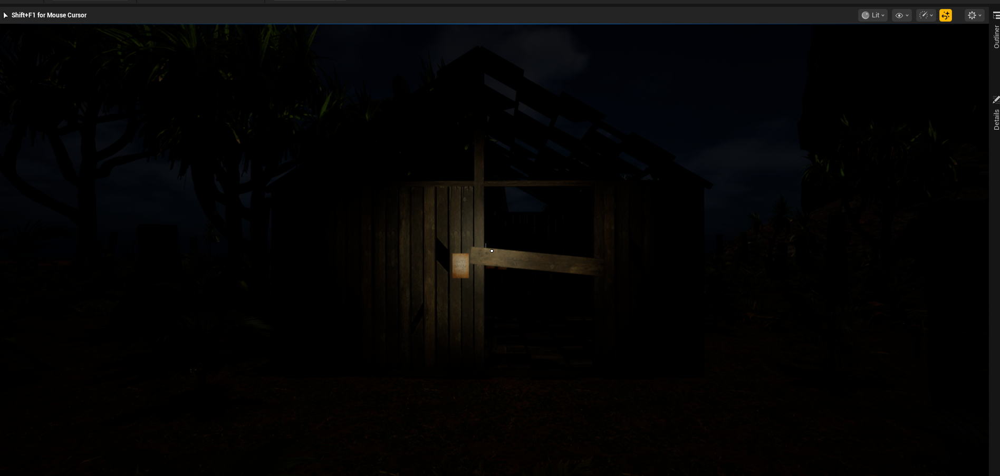
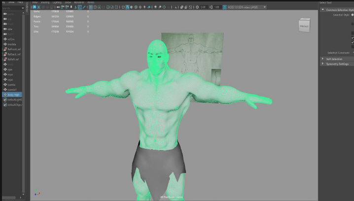
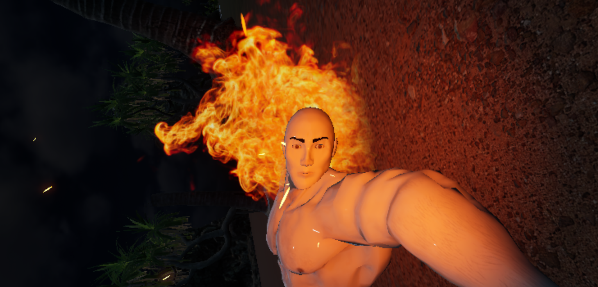

# La Isla de Zambo

Prototipo académico de terror y exploración en primera persona, desarrollado en equipo con **Unreal Engine 5.7** para PC con Windows de 64 bits. Este repositorio reúne su presentación, capturas y un resumen del proceso de desarrollo.

Marco llega de noche a una isla tropical. Al explorar sus cabañas encuentra notas, una llave y un libro maldito relacionados con Zambo. La experiencia combina búsqueda de pistas, interacción con objetos y eventos cinematográficos dentro de un nivel.

## Video de demostración

[Ver gameplay y cinemáticas (3 min 42 s, MP4)](video/Gameplay-Cinematicas.mp4)

La demostración muestra el menú, la exploración y el evento cinematográfico final. Copia de visualización en 1080p a 30 FPS, de aproximadamente 44 MiB.

## Mecánicas documentadas

- Movimiento y exploración en primera persona.
- Interacción con notas, puertas y cajones mediante detección de objetos.
- Progresión vinculada a la búsqueda de páginas.
- Linterna con encendido, apagado y efectos de sonido.
- Eventos narrativos y cinemáticas con control temporal de la cámara y restauración del control del jugador.

## Desarrollo

La lógica de interacción y los eventos se trabajan con **Blueprints**. El entorno integra iluminación, sonido ambiental, vegetación mediante PCG y efectos visuales.

El proceso artístico documentado incluye modelado y UV en **Autodesk Maya**, texturizado en **Substance 3D Painter** e integración de materiales en Unreal Engine. Los personajes utilizan rigs automáticos y animaciones de **Mixamo**. Estas tareas corresponden al trabajo del equipo.

## Mi participación

Soy **Jairo Alberto Vera Hernández**. En la última entrega participé en el guion de la cinemática, la grabación del gameplay y la integración y presentación de la documentación técnica. El proyecto se realizó de forma colaborativa; las capturas muestran el resultado del equipo.

## Perfil y herramientas

Busco mi primera oportunidad profesional en desarrollo de videojuegos. Mi formación incluye modelado en **Maya y ZBrush**, texturizado, animación en **Maya** y programación básica mediante **Blueprints**. Actualmente estoy aprendiendo **C++ básico aplicado a Unreal Engine**.

## Controles documentados

| Entrada | Acción |
| --- | --- |
| F | Encender o apagar la linterna |
| Clic izquierdo | Interactuar con el objeto seleccionado |

## Recursos y créditos

Además del contenido creado por el equipo, la documentación identifica estos recursos:

- **Tropical Plants Pack M02P**, de MozzarellaARC: vegetación.
- **Nordic Coastal Cliff**, de Quixel Megascans: rocas del entorno.
- **Water**, de Epic Games: agua.
- **Mixamo**, de Adobe: rigs y animaciones de personajes.
- **Fire VDB Pack Loop**, de one.studio2: recurso de fuego.
- **Create realistic horror game in Unreal Engine 5 Blueprints**, de Konieczny: referencias de implementación y algunos recursos visuales.
- **Creating and animating a caveman scene in Maya**, de Ahmed: textura de ojos.

Los recursos externos conservan sus condiciones de uso. Los créditos no conceden permiso para redistribuir sus archivos originales.

## Estado

Proyecto académico en fase de prototipo. La presentación corresponde a la versión para PC. Este repositorio contiene material de portafolio; los paquetes de assets y los archivos completos del proyecto se conservan por separado.
